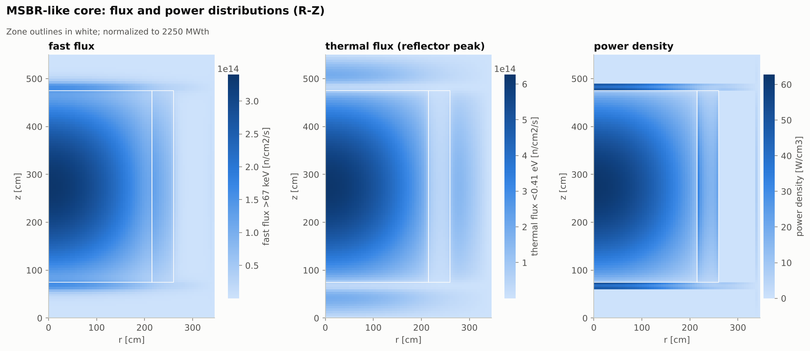
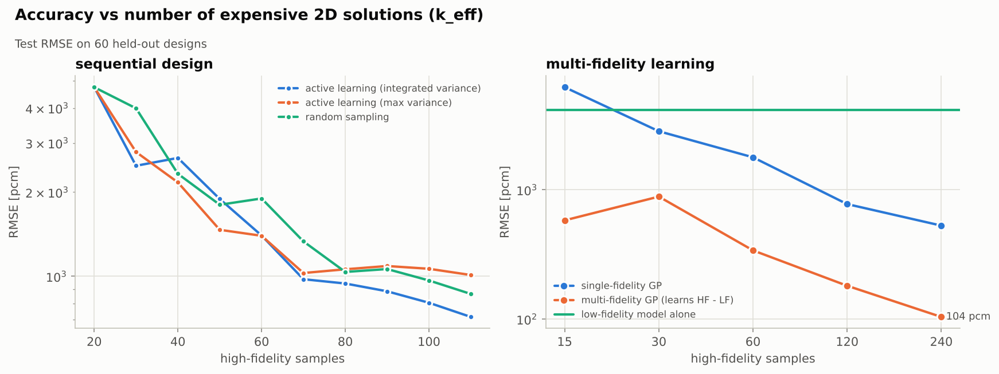

# MSR-NX — AI/ML-augmented neutronics design framework for Molten Salt Reactors

MSR-NX is a self-contained Python framework that covers the **complete neutronics
design chain of a molten salt reactor** — from nuclear data to core physics,
kinetics, poisoning and fuel-cycle depletion — and couples it to an **AI/ML layer
whose job is to keep high-fidelity accuracy while making design exploration
thousands of times faster**: uncertainty-aware surrogates, active learning,
physics-guarded prediction, multi-fidelity correction, parameter reduction,
reduced-order models, uncertainty quantification and Bayesian optimization.

Every study prints its results as tables **and** saves charts; `examples/run_all.py`
assembles everything into [`results/REPORT.md`](results/REPORT.md) (renders on GitHub)
and a self-contained `results/report.html`.



---

## What is inside

| Area | Capability | Module |
|---|---|---|
| Nuclear data | 50-nuclide database (Th/U/Pa/Np/Pu/Am chains, carrier salts, graphite, structural, Xe/Sm + chemistry-class FP lumps); synthetic pointwise cross sections from SLBW resonances with **exact Doppler broadening** (Faddeeva ψ–χ), statistical resonance ladders, calibrated to 2200 m/s values and resonance integrals | `msrnx.data`, `msrnx.xs.pointwise` |
| Multigroup library | 45 groups, **Bondarenko self-shielding tables** (σ₀ × T), free-gas thermal kernel (exact, detailed balance), elastic/inelastic/(n,2n) transfer matrices, ν, χ, κ; cached on disk | `msrnx.xs.library`, `msrnx.xs.kernels` |
| Materials | FLiBe, FLiNaK, MSRE/MSBR salts, chloride salts; ideal-mixing density model with thermal expansion; graphite with impurity, Hastelloy-N, B4C | `msrnx.materials` |
| Lattice physics | Equivalence-theory self-shielding (Sauer Dancoff, Bell factor), **2-region collision probability cell**, B1/P1 leakage, critical buckling, homogenization, condensation, **six-factor formula**, neutron balance, conversion ratio | `msrnx.lattice`, `msrnx.macro` |
| Core physics | Finite-volume **multigroup diffusion** (slab/cylinder/sphere/R-Z), forward + **adjoint**, ARPACK higher modes (dominance ratio); two-step sequence lattice → 1D spectral zones → 2D R-Z with reflectors, plena, downcomer, vessel, control rod | `msrnx.diffusion`, `msrnx.core` |
| Design outputs | k_eff, power density & peaking, flux maps, β_eff (adjoint-weighted), Λ, leakage, graphite fast fluence & lifetime, tritium production, inventories | `msrnx.core.CoreResult` |
| Reactivity & control | Fuel Doppler / density / total, graphite, isothermal and void coefficients; control rod S-curve and differential worth; shutdown margin; criticality searches; moderation studies | `msrnx.reactivity` |
| Kinetics | **Circulating-fuel precursor drift** (uniform and importance-weighted axial models), multi-node circulating point kinetics with fuel/graphite feedback, advected loop + heat exchanger, inhour, transients (step, ULOF, overcooling, scram), decay heat | `msrnx.kinetics` |
| Poisons | Xe-135 / Sm-149 equilibrium and transients with **He sparging** and rare-earth removal; transport-calibrated worths | `msrnx.poisons` |
| Burnup | Depletion chain from the database, **CRAM-16** matrix exponential, CE/CM predictor–corrector, **online reprocessing** (sparging, plate-out, rare-earth extraction, Pa decay tank, salt discard), criticality-controlled fissile feed / extraction, fertile make-up, breeding ratio, tritium | `msrnx.depletion` |
| AI / ML | GP (ARD Matérn), deep-ensemble MLP, gradient boosting, polynomial ridge; CV model selection; **IMSE active learning**; **physics-guarded hybrid predictor**; **multi-fidelity** HF/LF discrepancy learning; **Sobol, Morris, active subspaces**; **POD ROM**; cross-section functionalization (PCA); nuclear-data sensitivity & UQ; **constrained Bayesian optimization**; **ML-accelerated depletion** | `msrnx.ml` |

## Quick start

```bash
pip install -r requirements.txt
```

```python
from msrnx import msbr_design, solve_core
r = solve_core(msbr_design())          # lattice -> spectral zones -> 2D R-Z, ~2 s
print(r.summary())                     # k_eff, beta_eff, Lambda, CR, peaking, graphite life ...
```

```bash
python examples/run_all.py             # every study + REPORT.md / report.html (~20 min, 4 cores)
python examples/run_all.py 03 07       # selected studies
python -m pytest                       # 68 verification tests (~25 s)
```

The 45-group library is generated on first use (~6 s on 4 cores) and cached in
`~/.cache/msrnx` (override with `MSRNX_CACHE`).

## The ten studies

| # | Study | Highlights |
|---|---|---|
| 01 | [Nuclear data](examples/01_nuclear_data.py) | calibration table, Doppler broadening, Bondarenko curves, group XS, free-gas kernel |
| 02 | [Lattice physics](examples/02_lattice_physics.py) | moderation curve, resonance lumping (+14 % k∞), spectra, four-factor formula, absorption balance |
| 03 | [Core analysis](examples/03_core_analysis.py) | flux/power/adjoint maps, profiles, region spectra, 4 reference designs, group-condensation error |
| 04 | [Reactivity & control](examples/04_reactivity_control.py) | temperature coefficients with Doppler/density split, void, rod S-curve, shutdown margin, criticality search |
| 05 | [Kinetics & transients](examples/05_kinetics_transients.py) | MSRE circulation benchmark, β vs pump flow, inhour, step / ULOF / overcooling / scram |
| 06 | [Xenon & samarium](examples/06_xenon_samarium.py) | sparging effectiveness, iodine pit suppression, load following, samarium after shutdown |
| 07 | [Burnup](examples/07_burnup_depletion.py) | breeding with/without processing, fissile balance, Pa-233, FP poisoning, actinides, tritium, LEU feed, 2D vs ROM vs ML-accelerated |
| 08 | [ML surrogates](examples/08_ml_surrogates.py) | CV model comparison, parity with uncertainty, active learning, multi-fidelity, guarded hybrid, speed-up |
| 09 | [Parameter reduction](examples/09_parameter_reduction.py) | Sobol, Morris, active subspace, reduced-input surrogates, POD ROM, XS functionalization |
| 10 | [UQ & optimization](examples/10_uq_optimization.py) | nuclear-data sensitivities, tolerance Monte Carlo, constrained Bayesian optimization, verified Pareto front |



## Verification and benchmarks

**Analytic verification** (all in the test suite):

| Check | Result |
|---|---|
| 2-group bare sphere (exact mode) | 0.01 pcm, second-order convergence |
| 1-group finite cylinder, exact Marshak transcendental solution | 0.14 pcm |
| Forward vs adjoint eigenvalue | identical to 1e-14 |
| Free-gas kernel: normalization / detailed balance / cold limit | 1e-8 / 1e-8 / exact |
| CRAM-16 vs `scipy.linalg.expm` (stiff Th→Pa→U chain, with feed) | 8e-14 relative |
| Sobol estimator vs analytic Ishigami indices | ±0.002 |
| Synthetic cross sections vs database targets (all 50 nuclides) | thermal 0.1 %, RI 2 % |

**Comparison with historical reactors** (simplified R-Z models, built-in data):

| Quantity | MSR-NX | Reported |
|---|---|---|
| MSRE reactivity loss from fuel circulation (U-235) | 210 pcm | ≈ 212 pcm (measured) |
| MSRE fuel-salt / graphite temperature coefficient | −6.9 / −4.7 pcm/K | ≈ −8.7 / −6.7 pcm/K |
| MSBR fuel-salt temperature coefficient | −3.3 pcm/K | ≈ −3.2 pcm/K |
| MSBR breeding ratio with reference processing | 1.08 | 1.06 (design) |
| MSBR graphite lifetime | 3.3 years | ≈ 4 years |
| U-238 6.67 eV capture peak at 294 K | 7,186 b | ≈ 7,000 b |

**AI/ML accuracy** (nine-parameter thorium-breeder design space, k_eff range 0.83–1.58):

| Method | Result |
|---|---|
| GP surrogate, 240 training designs | R² = 0.9993, CV RMSE ≈ 530 pcm, calibrated 95 % intervals |
| Multi-fidelity GP (learns 2D − lattice discrepancy) | **≈ 100 pcm** RMSE with 240 runs (vs 530 single-fidelity, 4,150 low-fidelity alone) |
| Physics-guarded hybrid (σ < 150 pcm) | 96 % of queries answered by ML, 87 pcm RMSE |
| Surrogate vs 2D solver cost | more than 10,000× faster per evaluation |
| ML-accelerated depletion | 1.6× fewer transport solves, ΔBR < 5e-4, Δk < 20 pcm |
| Energy-group reduction 45 → 6 groups (2D) | 42 pcm |
| POD of 2D power maps | 7 modes (86× compression), 2 % mean error on unseen designs |
| Cross-section functionalization | 10 constants on a 4-D state space → 4 functions, < 1 % error |

## How accuracy is maintained by the AI layer

1. **Uncertainty everywhere** — every surrogate returns a predictive σ; 95 % coverage is checked by cross-validation.
2. **Active learning (IMSE)** — new expensive runs go where they reduce the integrated predictive variance most.
3. **Multi-fidelity** — ML learns only the smooth discrepancy between a cheap physics model and the full solver.
4. **Physics guard** — the ML answers only if its σ is below tolerance and the query is inside the trained domain; otherwise the physics solver runs and the model retrains.
5. **Trust-gated acceleration** — in depletion, ML transport is used only after it has passed a physics check, with periodic re-validation and extrapolation detection.
6. **Robust optimization** — constraints are imposed on the confidence bound (μ − κσ) and optima are re-verified with physics, then fed back to the training set.

## Parameter reduction

* **Global sensitivity** (Sobol S₁/S_T with bootstrap CIs, Morris μ*/σ) ranks design inputs; `reduce_parameters(..., target_rmse=)` drops only inputs whose variance share √(S_T·Var) is below the accuracy target.
* **Active subspaces** find the dominant linear combinations of inputs.
* **Energy-group condensation** with spectral-zone spectra (45 → 2–8 groups).
* **POD** compresses spatial fields; **PCA functionalization** compresses few-group cross-section tables.

## Limitations — read before using results

* The built-in nuclear data are **representative, synthesized from well-known
  parameters** (thermal cross sections, resonance integrals, low-lying resonance
  parameters, average resonance statistics). They reproduce MSR physics trends and
  the benchmarks above, but they are **not an evaluated library**. For licensing-grade
  work, inject group constants from ENDF/B-VIII.0 / JEFF-3.3 processing
  (`Library.add_external`) or couple to a Monte Carlo code.
* Graphite thermal scattering uses the **free-gas** kernel (no S(α,β) crystal binding);
  this is why the MSBR graphite coefficient sign differs from the reported value.
* Core solutions use **diffusion theory** on homogenized R-Z zones; fission products
  beyond Xe/Sm/Pm/I are represented by four chemistry-class lumps.
* Kinetics uses point kinetics with axial shapes (no space–time 3D dynamics or
  thermal-hydraulic CFD).

## Project layout

```
msrnx/
  constants.py  materials.py  macro.py  lattice.py  diffusion.py  core.py
  kinetics.py   reactivity.py poisons.py plotting.py report.py
  data/         nuclides, fission yields, delayed neutrons
  xs/           group structures, pointwise synthesis, kernels, Bondarenko library
  depletion/    chain + reprocessing, CRAM-16, burnup driver
  ml/           design space, surrogates, active learning, sensitivity, ROM,
                multi-fidelity, UQ, optimization, XS functionalization, ML depletion
examples/       10 studies + run_all.py (tables + charts + reports)
tests/          68 verification tests
results/        figures, study.json files, REPORT.md
```
