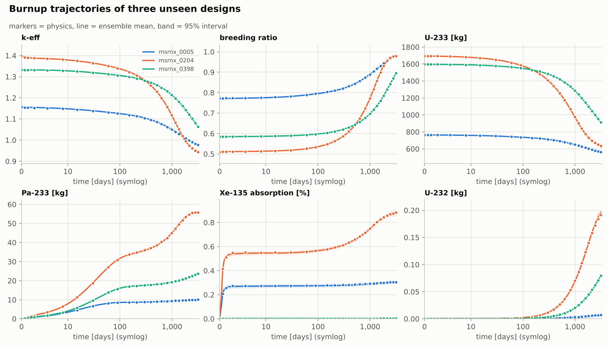
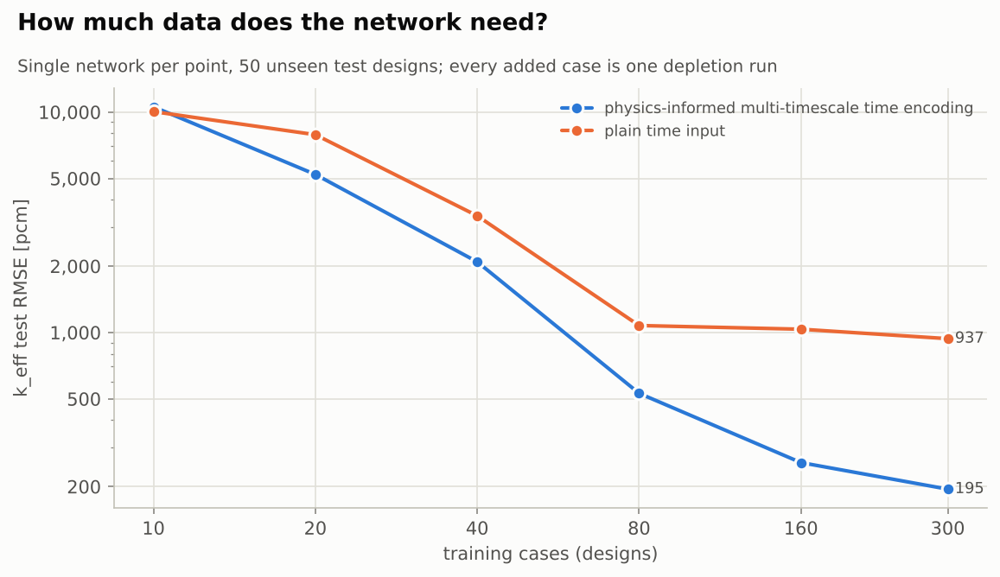
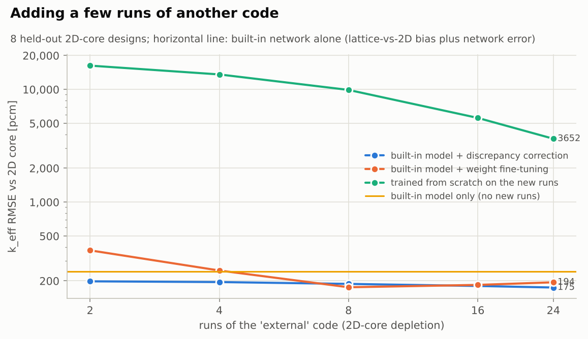

# Neural-network burnup framework (`msrnx.burnup_nn`)

Learn **burnup trajectories** of a molten salt reactor - k_eff, breeding ratio,
burnup, actinide and poison inventories, absorption fractions - as functions of
design / operating parameters and time, from **any depletion data**:

* the built-in MSR-NX coupled transport-depletion runs (generated for you),
* your own results from Serpent, SCALE/TRITON, OpenMC, MCNP/CINDER, ORIGEN or an
  in-house code,
* or both, merged into one training set.

The trained network gives a full trajectory with an uncertainty band in a few
milliseconds, the cycle length / discharge burnup of a design, design maps,
and input sensitivities. Every run writes charts and a Markdown/HTML report.

The networks are written in pure NumPy, so no deep-learning framework is
needed and the code runs on any machine that runs MSR-NX.



---

## 1. Five-minute start

```bash
pip install -e .                                   # from the repository root
python examples/11_burnup_neural_network.py        # full demonstration (~15 min)
```

or step by step with the command line:

```bash
python -m msrnx.burnup_nn generate --cases 400 --out results/11_burnup_neural_network/physics_dataset.csv
python -m msrnx.burnup_nn check   examples/burnup_nn/config.json
python -m msrnx.burnup_nn train   examples/burnup_nn/config.json
python -m msrnx.burnup_nn predict --model runs/burnup_nn_demo/model --input examples/burnup_nn/new_designs.csv --crossing-target k_eff
```

`train` writes `REPORT.md` / `report.html`, all charts, `test_metrics.csv`,
`test_predictions.csv`, and the model (`model/model.json` + `model/weights.npz`).

## 2. Adding your data

### File format: one row per case and time point

| case_id | time_days | uf4_pct | thf4_pct | ... (features) | k_eff | U233_kg | Pa233_kg | ... (targets) |
|---|---|---|---|---|---|---|---|---|
| run_01 | 0 | 0.35 | 10.0 | ... | 1.3248 | 1141.1 | 0.0 | ... |
| run_01 | 30 | 0.35 | 10.0 | ... | 1.3037 | 1112.3 | 9.45 | ... |
| run_02 | 0 | 0.42 | 8.0 | ... | 1.4410 | 1520.7 | 0.0 | ... |

* **case_id**: one depletion trajectory (one design or one run).
* **time column**: days by default. Burnup (MWd/kgHM) or EFPD work too; set
  `"time_column"`. Each case can have its own time grid, so coarse Serpent steps
  and fine built-in steps can be mixed.
* **features** (network inputs): design / operating parameters, usually constant
  within a case. A column that changes with time (e.g. a power history) is
  accepted as a time-dependent input.
* **targets** (outputs): any numeric results. **Blank cells are allowed**, e.g.
  when your code does not report Xe-135; the loss skips them.
* optional **weight** column: per-row training weight.

Supported files are CSV/TSV, Excel (`.xlsx`), JSON, Parquet and NPZ, or build a
`pandas.DataFrame` and call `BurnupDataset(df)`. To get an empty file with the
right columns:

```bash
python -m msrnx.burnup_nn template --out my_runs.csv \
    --features uf4_pct thf4_pct salt_fraction power_MW --targets k_eff U233_kg Pa233_kg
```

### Different column names or units

Map them in the config (or in `BurnupDataset.load`). Nothing in your files needs
to be edited by hand:

```json
{"path": "serpent_runs.xlsx", "source": "serpent", "sheet": "depletion",
 "rename":    {"Case": "case_id", "EFPD": "time_days", "ANA_KEFF": "k_eff", "U233_g": "U233_kg"},
 "scale":     {"U233_kg": 0.001},
 "constants": {"T_fuel": 900.0},
 "query":     "time_days <= 2000",
 "weight":    3.0}
```

* `rename`: your column name → framework name (applied first)
* `scale`: unit conversion factor after renaming
* `constants`: add a column with a fixed value, for a feature that your runs did not
  vary but other data sets do
* `query`: select rows (pandas syntax)
* `weight`: trust this file more (or less) in training

### Mixing codes of different fidelity

Your code and the built-in physics will differ systematically (nuclear data,
transport method, geometry detail). There are three ways to combine them,
depending on how many runs you have:

1. **Discrepancy correction (a few runs, from about 2).** Keep the pre-trained
   network and learn only the difference to your code: a ridge regression on the
   network inputs, their products with the time encoding, and the network's own
   output (so a multiplicative bias is captured as well). The ridge penalty is
   chosen by leave-one-case-out cross-validation, and an output is left unchanged
   unless correcting it lowers the cross-validated error.

   ```bash
   python -m msrnx.burnup_nn finetune examples/burnup_nn/finetune_config.json \
       --model results/11_burnup_neural_network/model --method correction
   ```

2. **Weight fine-tuning (roughly ten runs or more).** All weights continue training
   from the pre-trained values and are pulled back towards them (`--anchor`, L2-SP).
   Outputs absent from the new data keep their pre-trained behaviour, and
   `--freeze N` fixes the first N layers (`--method weights`). With very few runs
   this can overfit, which is why `--method auto` (the default) uses the correction
   below 12 training cases.
3. **Fidelity flag (merge everything, retrain).** Add `"constants": {"fidelity": 0}`
   to the built-in data and `{"fidelity": 1}` to your code's data, and list
   `fidelity` as a feature. The network learns the difference between the codes
   instead of averaging it out; predict with `fidelity = 1`
   (`examples/burnup_nn/config.json`).

Study 11 compares these approaches on 2D-core depletion runs (see section 7).
Starting from a network pre-trained on many cheap runs is what makes a handful of
expensive runs useful: a network trained from scratch on so few runs is an order
of magnitude less accurate.

### Generating more built-in data

```bash
python -m msrnx.burnup_nn generate --cases 200 --seed 3 --out more.csv \
    --range uf4_pct=0.3:0.5 --range power_MW=800:1200 [--transport core] [--feed]
```

`--transport core` runs the full 2D R-Z diffusion at every step (about 10× slower,
higher fidelity). `--feed` holds k_eff = 1 with U-233 feed and writes feed
columns. For another design family, pass your own `space` (DesignSpace) and
`builder(p) -> (MSRDesign, Reprocessing)` to `generate_physics_dataset` in
Python.

## 3. The configuration file

| key | meaning | default |
|---|---|---|
| `data` | list of files (strings or objects with `path`, `source`, `rename`, `scale`, `constants`, `query`, `sheet`, `weight`) | required |
| `features`, `targets` | column lists | required |
| `case_column`, `time_column` | identifiers (`time_column: null` gives a static surrogate) | `case_id`, `time_days` |
| `log_targets`, `log_features` | `"auto"`, `"none"`, `"all"` or a list | `"auto"` |
| `monotonic` | `"auto"` (targets monotone in every case), `{}` or `{"burnup_MWd_kgHM": "increasing", ...}` | `"auto"` |
| `target_weights` | relative loss weights, e.g. `{"k_eff": 3}` | equal |
| `model` | network options, see below | |
| `split` | `{"test": 0.15, "val": 0.15, "seed": 0}`, always **by case** | |
| `crossing` | `{"target": "k_eff", "level": 1.0, "burnup_target": "burnup_MWd_kgHM"}` adds a cycle-length table | none |
| `plots` | `color_by`, `trajectory_targets`, `n_trajectory_cases`, `max_panels` | |
| `output_dir` | results folder (relative to the config file) | `burnup_nn_run` |

`model` options (`NNConfig`): `hidden` [64, 64, 64], `activation` tanh
(silu/gelu/softplus/relu), `ensemble` 5, `optimizer` auto (L-BFGS up to 60k
rows, then Adam), `max_iter` 5000, `lbfgs_memory` 100, `epochs`/`batch_size`/`lr` (Adam), `l2`,
`patience`, `time_encoding` multiscale|linear, `n_time_scales` 4,
`monotonic_weight` 1, `bootstrap`, `n_jobs`, `seed`.

## 4. Python API

```python
from msrnx.burnup_nn import BurnupDataset, BurnupNN, learning_curve

data = (BurnupDataset.load("results/11_burnup_neural_network/physics_dataset.csv")
        + BurnupDataset.load("serpent.xlsx", rename={"EFPD": "time_days"}, source="serpent"))
data.check(features, targets)                     # raises on unusable data
print(data.detect_monotonic(targets))             # candidates for constraints
train, val, test = data.split(test=0.15, val=0.15)

model = BurnupNN(features, targets, monotonic={"burnup_MWd_kgHM": "increasing"},
                 hidden=(64, 64, 64), ensemble=5).fit(train, val)
model.evaluate(test)                              # RMSE, R2, % of range, coverage ...
model.predict(test)                               # mean + calibrated sigma per target
model.predict_trajectory({"uf4_pct": 0.35, ...})  # one design, dense time grid
model.crossing(designs, "k_eff", 1.0, burnup_target="burnup_MWd_kgHM")  # cycle length
model.sensitivity(designs, "k_eff", times=[1500]) # d target / d input (per 1 sigma)
model.in_domain(new_rows)                         # extrapolation check
model.fit_correction(few_runs_of_your_code)       # learn only the code-to-code difference
model.fine_tune(more_runs_of_your_code)           # or continue training the weights
learning_curve(features, targets, train, val, test, sizes=[10, 20, 40, 80])  # data needs
model.save("my_model"); BurnupNN.load("my_model")
```

Charts: `msrnx.burnup_nn.plots` (`data_overview`, `history`, `parity_grid`,
`trajectories`, `error_vs_time`, `accuracy_bars`, `calibration`,
`sensitivity_chart`, `crossing_map`, `series_curves`).

## 5. What makes it work with little data

| Feature | Why |
|---|---|
| Multi-timescale time encoding: t, √t, 1−exp(−t/τ) on log-spaced τ | Depletion solutions are sums of exponentials (Xe-135 in hours, Pm/Sm-149 in days, Pa-233 in weeks, actinides over years); the network only learns their amplitudes. In study 11 this needs several times fewer runs for the same accuracy than a plain time input. |
| Log-space targets (`auto`) | Inventories spanning decades (U-232, Np-237, Pu, Xe) are learned as relative quantities and can never be negative. |
| Non-negativity guard | Quantities never negative in training are clipped at 0 (matters at t = 0). |
| Monotonicity constraints | Burnup, build-up chains or Th-232 consumption must not reverse; penalised at collocation points across all time scales, including the first step after t = 0. |
| Masked loss | Codes reporting different outputs can be merged. |
| Deep ensemble + calibration | Every prediction carries a 1-sigma, scaled on validation cases so that 95 % intervals cover about 95 %. |
| Split by case | No time point of a test design is ever seen in training, so reported errors are honest. |

## 6. Limitations

* The network interpolates. Designs outside the training ranges are flagged
  (`in_domain`, `extrapolation` column in `predict`). Add runs there instead of
  trusting the extrapolation.
* Accuracy is bounded by the data: the network reproduces its training code,
  including that code's approximations. The built-in data come from a
  2D-calibrated lattice model with representative (not evaluated) nuclear data;
  see the main README.
* Time-dependent features (power histories) are accepted, but a pointwise network
  sees only the current value, not the history. For load-following histories,
  add history features such as cumulative burnup.

## 7. Results of study 11 (built-in thorium MSR data)

400 designs × 26 burnup points (0–3150 days); inputs: UF4, ThF4, salt volume
fraction, power, and rare-earth / Pa / Xe removal times; 12 outputs; split
300 / 50 / 50 designs (train / validation / test). Full results:
[results/REPORT.md](../results/REPORT.md#11-neural-network-burnup-framework).

| Result | Value |
|---|---|
| k_eff on 50 unseen designs (k range 0.75–1.69) | **84 pcm RMSE**, max 533 pcm |
| All 12 outputs | mean R² 0.9999; mean RMSE 0.16 % of range |
| Calibrated 95 % intervals | 97 % of unseen points covered |
| Data needs (single network) | multi-timescale encoding: 530 pcm with 80 cases, 195 pcm with 300; plain time input: 937 pcm with 300 |
| Cycle length and discharge burnup | within 1 % of physics runs at the checked designs (see the map table) |
| Adding runs of a 2D-core code (2, 4, 8, 16, 24 runs) | built-in network alone 241 pcm; + discrepancy correction 198, 195, 188, 180, 175 pcm; + weight fine-tuning 373, 247, 176, 184, 194 pcm; trained from scratch 16,274, 13,591, 9,904, 5,590, 3,652 pcm |
| Cost | 1.3 ms per trajectory (200 times, mean + sigma) vs 1.2 s per physics depletion run |




Reading the transfer result: the built-in lattice model is already close to
2D-core depletion (the same nuclear data), so the code-to-code gap is small and
the correction gains a modest but consistent amount, from 2 runs on. Weight
fine-tuning is worse than no adaptation with 2 runs and competitive from about 8.
A code with different nuclear data or geometry differs much more, and then the
adaptation matters more. In every case, starting from the pre-trained network is
what makes a handful of expensive runs useful.
