# MSR-NX Neutronics Design Report

_Generated 2026-11-04 03:09 by `examples/run_all.py`._

## Contents
- [1. Nuclear data and the 45-group library](#1-nuclear-data-and-the-45-group-library)
- [2. Lattice physics: MSBR-type fuel channel in graphite](#2-lattice-physics-msbr-type-fuel-channel-in-graphite)
- [3. Full-core neutronics (2D R-Z multigroup diffusion)](#3-full-core-neutronics-2d-r-z-multigroup-diffusion)
- [4. Reactivity feedback, control rods and criticality](#4-reactivity-feedback-control-rods-and-criticality)
- [5. Circulating-fuel kinetics and transients](#5-circulating-fuel-kinetics-and-transients)
- [6. Xenon and samarium poisoning with off-gas sparging](#6-xenon-and-samarium-poisoning-with-off-gas-sparging)
- [7. Burnup and depletion with online fuel processing](#7-burnup-and-depletion-with-online-fuel-processing)
- [8. AI/ML surrogate modelling with accuracy control](#8-aiml-surrogate-modelling-with-accuracy-control)
- [9. Parameter reduction and reduced-order modelling](#9-parameter-reduction-and-reduced-order-modelling)
- [10. Uncertainty quantification and design optimization](#10-uncertainty-quantification-and-design-optimization)

## 1. Nuclear data and the 45-group library

Synthetic pointwise cross sections (SLBW resonances, exact Doppler broadening, statistical ladders) calibrated to 2200 m/s values and resonance integrals, collapsed to 45 groups with narrow-resonance Bondarenko self-shielding.

**Calibration of synthetic cross sections (barns): target vs generated**

| nuclide | sig_c target | sig_c | sig_f target | sig_f | RI_c target | RI_c | RI_f target | RI_f |
|---|---|---|---|---|---|---|---|---|
| Th232 | 7.35 | 7.35 | 0 | 0 | 85 | 85 | - | 0.37 |
| Pa233 | 39.5 | 39.5 | 0 | 0 | 860 | 860 | - | 3.26 |
| U233 | 45.5 | 45.5 | 531.2 | 531.2 | 140 | 140 | 764 | 764 |
| U234 | 100.1 | 100.1 | 0.067 | 0.067 | 660 | 660 | - | 4.52 |
| U235 | 98.7 | 98.7 | 585.1 | 585.1 | 144 | 144 | 275 | 275 |
| U238 | 2.683 | 2.683 | 0 | 0 | 280 | 280 | - | 1.4 |
| Pu239 | 270.7 | 270.7 | 747.4 | 747.4 | 200 | 200 | 303 | 303 |
| Pu240 | 289.5 | 289.5 | 0.056 | 0.056 | 8500 | 8500 | - | 5.36 |
| Pu241 | 361.1 | 361.1 | 1012 | 1012 | 162 | 162 | 570 | 570 |
| Xe135 | 2.65e+06 | 2.65e+06 | 0 | 0 | - | 8344.6 | - | 0 |
| Sm149 | 40140 | 40140 | 0 | 0 | 3400 | 3413.6 | - | 0 |
| Li6 | 0.039 | 0.039 | 0 | 0 | - | 0.02 | - | 0 |
| Li7 | 0.0454 | 0.0454 | 0 | 0 | - | 0.02 | - | 0 |
| Be9 | 0.0076 | 0.0076 | 0 | 0 | - | 0 | - | 0 |
| F19 | 0.0096 | 0.0096 | 0 | 0 | - | 0 | - | 0 |
| C12 | 0.00353 | 0.0035 | 0 | 0 | - | 0 | - | 0 |

**Effective resonance integral (b) and Doppler increase**

| nuclide | sigma0 [b] | RI 294 K | RI 900 K | Doppler +% |
|---|---|---|---|---|
| Th232 | 49 | 12.53 | 15.13 | 20.8 |
| Th232 | 203 | 21.93 | 26.79 | 22.16 |
| Th232 | 837 | 38.71 | 45.9 | 18.57 |
| U238 | 49 | 19.67 | 21.8 | 10.83 |
| U238 | 203 | 35.23 | 41.1 | 16.65 |
| U238 | 837 | 69.16 | 84.19 | 21.74 |

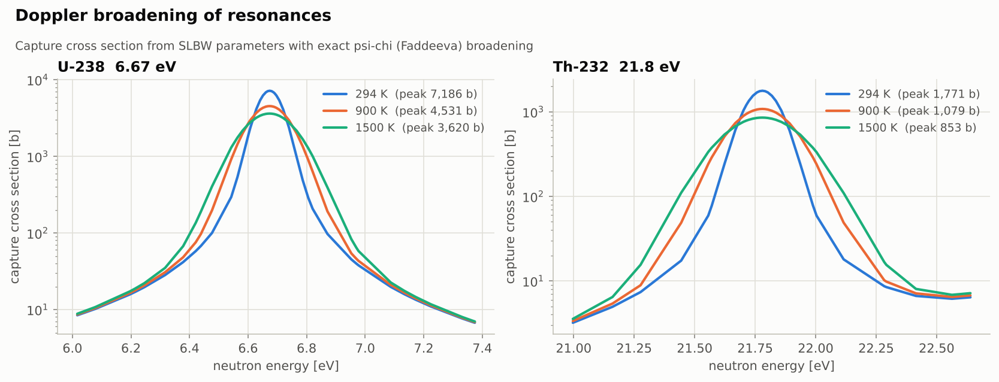
*Peak capture falls and the wings rise as temperature increases (area is preserved).*

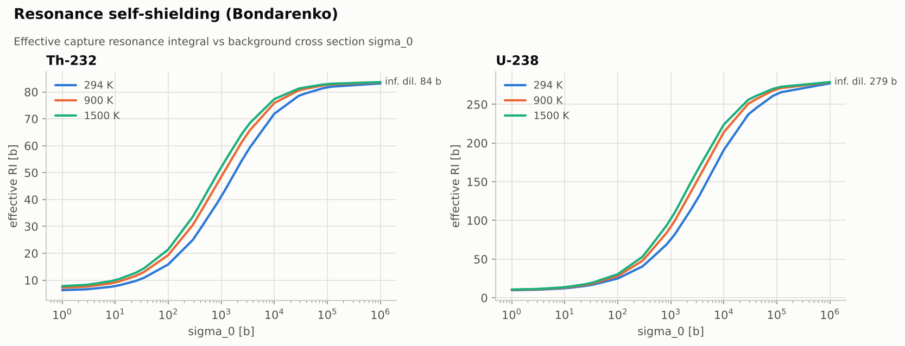
*Strong self-shielding at low dilution; higher temperature raises absorption (negative Doppler feedback).*

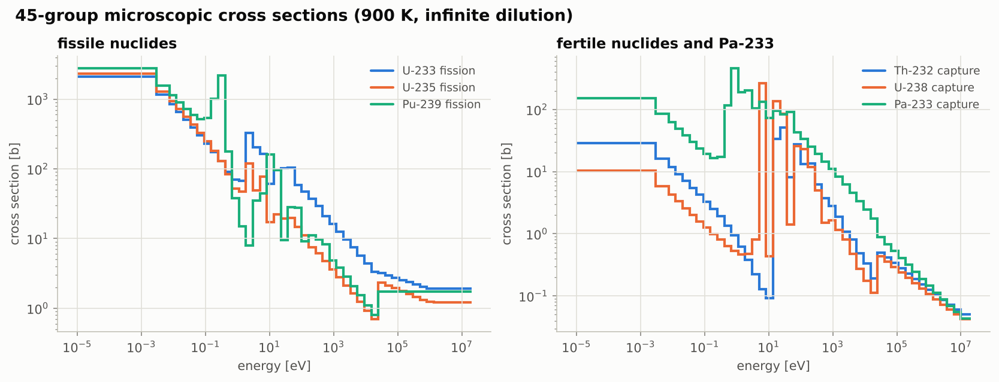
*Group-averaged cross sections used by the lattice code.*

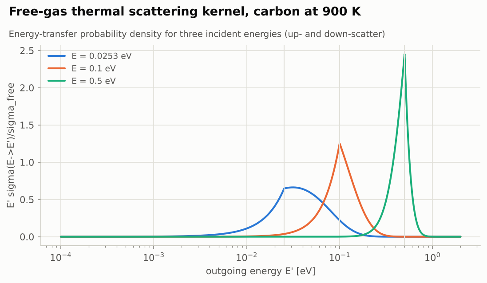
*Thermal neutrons gain energy from the hot graphite lattice (up-scatter) - origin of the moderator temperature effect.*

## 2. Lattice physics: MSBR-type fuel channel in graphite

Two-region collision-probability cell (Carlvik escape probability, Sauer Dancoff factor, Bell-Dancoff equivalence for self-shielding) with 45 energy groups.

**MSBR zone-I cell (salt fraction 0.13, channel radius 1.0 cm, hex)**

| model | k_inf | eta | f | p | epsilon | conv. ratio | sigma0 Th [b] | B2_crit [1/cm2] |
|---|---|---|---|---|---|---|---|---|
| heterogeneous (CP) | 1.1646 | 1.4127 | 0.9338 | 0.7027 | 1.2563 | 0.852 | 204.4 | 3.892e-04 |
| homogenized mixture | 1.0198 | 1.4129 | 0.9352 | 0.6059 | 1.2738 | 1.1282 | 840.8 | 5.032e-05 |

**Lumping effect**

| channel radius [cm] | k_inf | sigma0 Th [b] | Dancoff C |
|---|---|---|---|
| 0.3 | 1.0992 | 401.2 | 0.3903 |
| 1.04 | 1.1665 | 199.7 | 0.1175 |
| 1.78 | 1.1928 | 146.7 | 0.0528 |
| 2.52 | 1.2078 | 122.5 | 0.0278 |
| 3.26 | 1.2173 | 108.8 | 0.0159 |
| 4 | 1.2237 | 100 | 0.0097 |

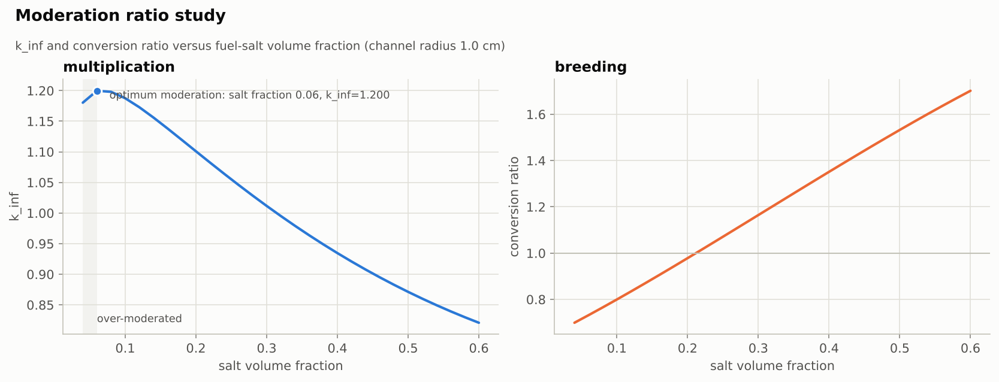
*Under-moderated lattices (high salt fraction) trade reactivity for breeding.*

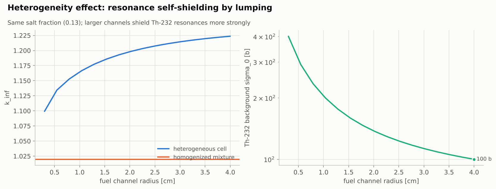
*Lumping the fuel lowers sigma_0 and raises the resonance escape probability.*

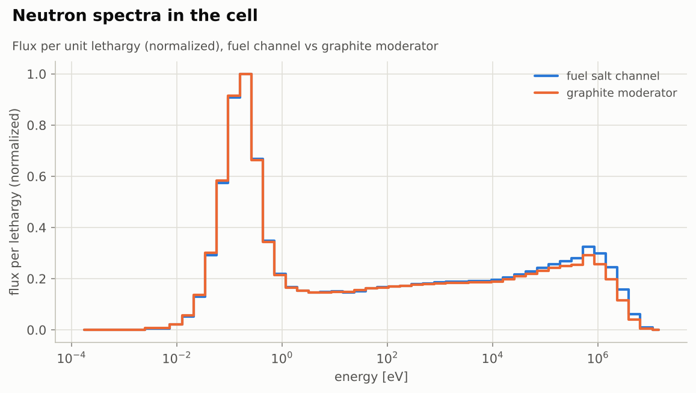
*Thermal disadvantage factor phi_mod/phi_fuel = 1.038.*

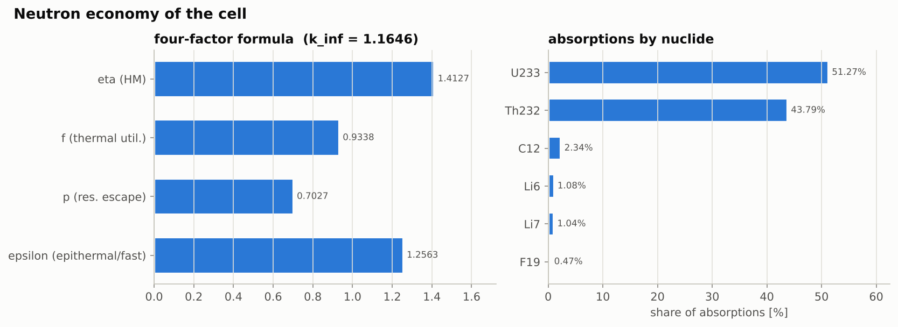
*Th-232 and U-233 dominate absorption; Li-6/Li-7 are the main parasitic absorbers.*

## 3. Full-core neutronics (2D R-Z multigroup diffusion)

Lattice calculations per zone, 1D radial/axial 45-group spectral-zone calculations, condensation to 8 groups and 2D forward/adjoint diffusion.

**MSBR-like core: key results**

| quantity | value |
|---|---|
| k_eff | 1.1109 |
| excess reactivity [pcm] | 9980 |
| k_inf zone I / zone II | 1.1646 / 1.0069 |
| dominance ratio k1/k0 | 0.955 |
| beta_eff static [pcm] | 271.6 |
| prompt generation time [us] | 358.4 |
| conversion ratio (clean) | 0.9088 |
| power peaking total / radial / axial | 2.59 / 3.24 / 1.71 |
| average / peak power density [W/cc] | 24.3 / 62.8 |
| power outside graphite zones | 8.4 % |
| neutron leakage from core zones | 2.54 % |
| peak graphite fast flux (>50 keV) [n/cm2/s] | 3.638e+14 |
| graphite lifetime [full-power years at CF] | 3.27 |
| tritium production [Ci/day] | 9082.4 |
| solve time [s] | 5.75 |

**Reference designs (clean, fresh fuel)**

| design | k_eff | beta_eff [pcm] | Lambda [us] | conv. ratio | peaking | fast flux peak | time [s] |
|---|---|---|---|---|---|---|---|
| MSRE-like | 1.0867 | 675.2 | 237 | 0.164 | 2.6 | 3.72e+13 | 0.1 |
| MSBR-like | 1.1108 | 271.6 | 358.9 | 0.909 | 2.6 | 3.66e+14 | 0.77 |
| TMSR-LEU | 1.0983 | 653.4 | 1199.9 | 0.28 | 1.92 | 1.00e+14 | 0.28 |
| Fast chloride MSR | 1.1197 | 677.2 | 1 | 0.611 | 2.02 | 9.15e+14 | 0.22 |

**Energy-group condensation (MSRE-like core, 2D)**

| structure | groups | k_eff | error vs 45g [pcm] | 2D solve [s] |
|---|---|---|---|---|
| 2g | 2 | 1.0796 | -632 | 0.024 |
| 4g | 4 | 1.0841 | -179.7 | 0.037 |
| 6g | 6 | 1.0855 | -42.4 | 0.055 |
| 8g | 8 | 1.0856 | -30.9 | 0.088 |
| 45g (reference) | 45 | 1.0859 | 0 | 7.221 |

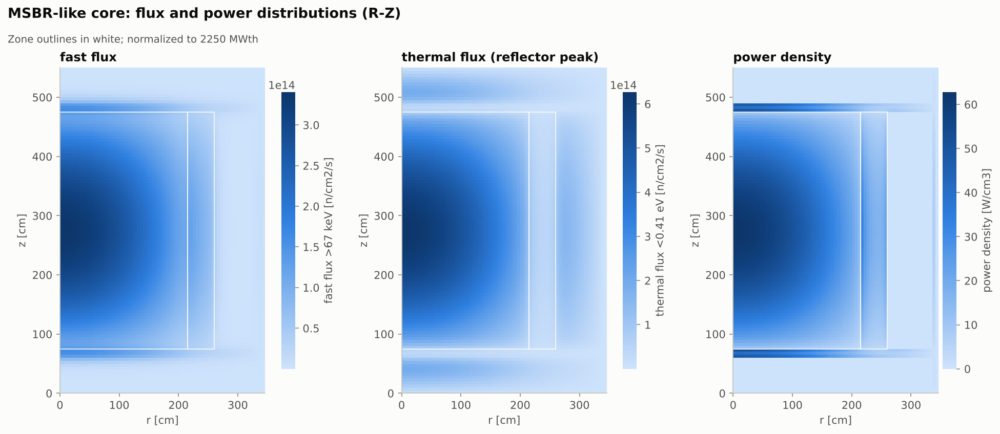
*Thermal flux peaks in the graphite reflector; power peaks in the well-moderated zone I.*

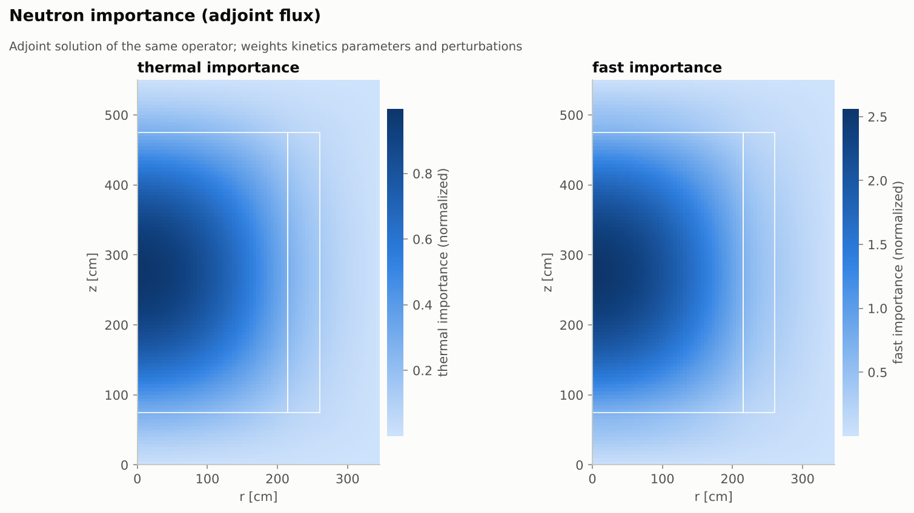
*Adjoint (importance) maps.*

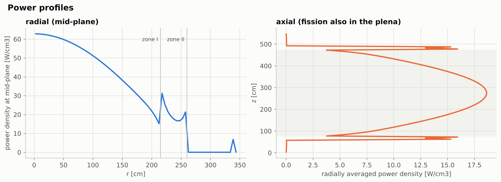
*Mid-plane radial and radially averaged axial power shapes.*

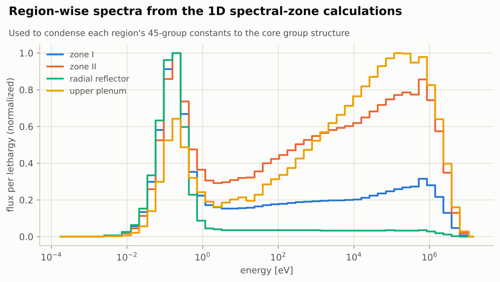
*The under-moderated zone II and the salt plena have harder spectra than zone I.*

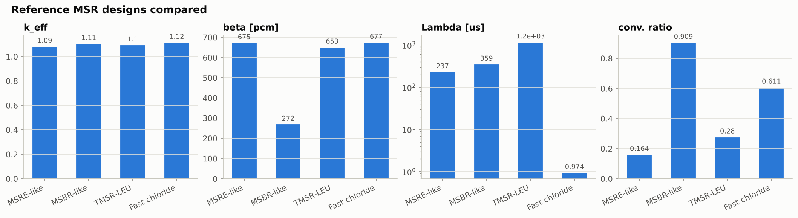
*Graphite-moderated cores have ~100x longer generation times than the fast chloride core; U-233 has the smallest beta.*

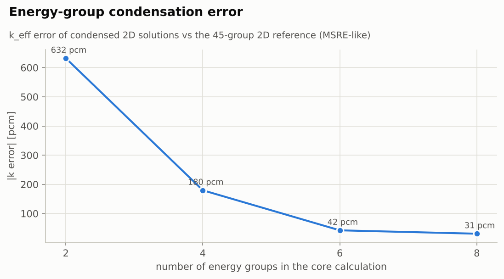
*Spectral-zone condensation keeps few-group errors small - a physics parameter reduction from 45 to a handful of groups.*

## 4. Reactivity feedback, control rods and criticality

All coefficients by central differences of full 2D core solutions; Doppler and density components separated by freezing either the cross sections or the density.

**Temperature coefficients of reactivity [pcm/K]**

| design | fuel Doppler | fuel density | fuel total | graphite | isothermal |
|---|---|---|---|---|---|
| MSRE-like | -2.4 | -4.53 | -6.93 | -4.7 | -11.63 |
| MSBR-like | -3.78 | 0.45 | -3.33 | -0.88 | -4.21 |
| TMSR-LEU | -3.86 | -2.62 | -6.47 | -4.71 | -11.19 |

**Comparison with historical values [pcm/K]**

| quantity | MSR-NX | reported |
|---|---|---|
| MSRE fuel salt | -6.93 | about -8.7 |
| MSRE graphite | -4.7 | about -6.7 |
| MSBR fuel salt | -3.33 | about -3.2 |
| MSBR graphite | -0.88 | about +2.3 (free-gas graphite omits S(a,b)) |

**Control rod and shutdown margin (MSRE-like, 3 identical rods, one stuck out)**

| quantity | value |
|---|---|
| single-rod worth [pcm] | 4729.5 |
| excess reactivity [pcm] | 7977.5 |
| available worth, stuck rod [pcm] | 9459.1 |
| shutdown margin [pcm] | 1481.6 |

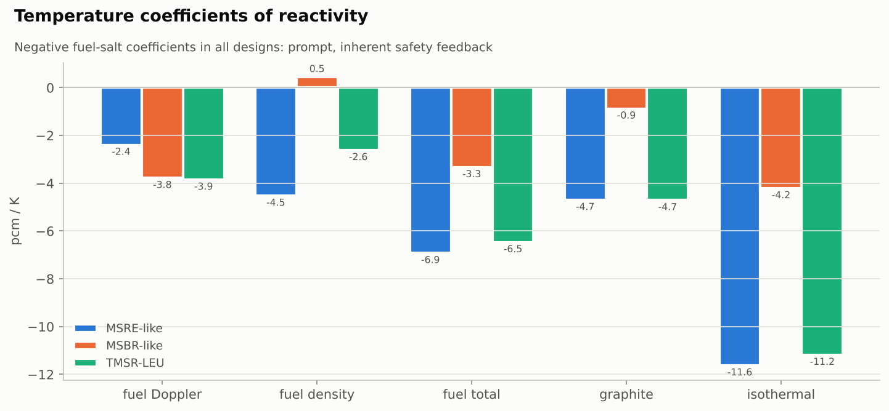
*Doppler dominates for the thorium breeder; salt expansion dominates for the small MSRE core.*

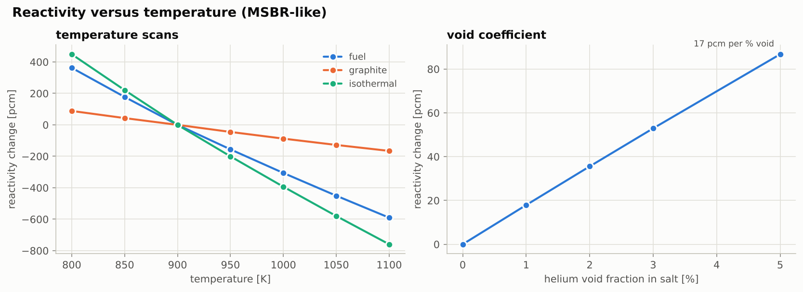
*Reactivity falls with fuel temperature and with helium voiding of the salt.*

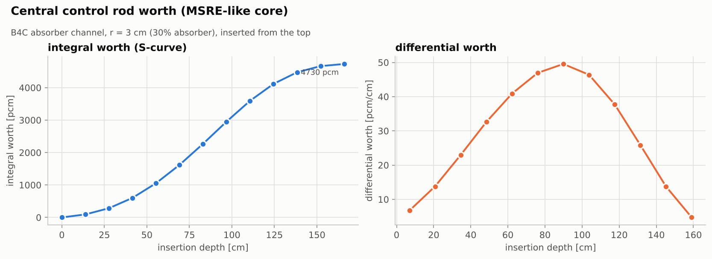
*Differential worth peaks where the flux-importance product is largest.*

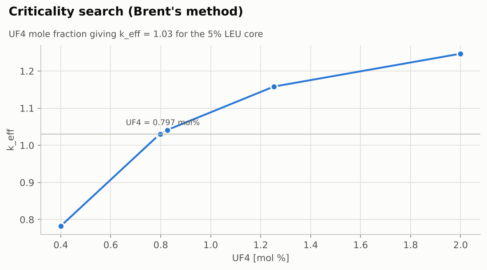
*Every point is a full 2D core solution.*

## 5. Circulating-fuel kinetics and transients

Precursor drift from importance-weighted slug flow; multi-node circulating point kinetics with fuel/graphite feedback and an advected heat-exchanger loop.

**MSRE reactivity loss from fuel circulation (U-235 fuel)**

| model | loss [pcm] |
|---|---|
| uniform slug flow (tau_c 8.46 s, tau_L 16.73 s) | 283.2 |
| importance-weighted, core + plena (MSR-NX geometry) | 210.5 |
| MSRE measurement | about 212 |

**Transient summary (MSBR-like)**

| transient | peak power | final power | extreme fuel dT [K] |
|---|---|---|---|
| +30 pcm step (circulating) | 1.229 | 1.061 | 8.2 |
| +30 pcm step (stationary) | 1.126 | 1.061 | 7.4 |
| unprotected loss of flow | 1 | 0.137 | 35.1 |
| overcooling -40 K | 1.371 | 1.341 | -4.5 |
| scram -2000 pcm (circulating) | 1 | 2.10e-03 | -104.4 |

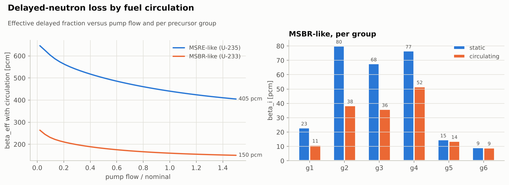
*Long-lived precursor groups (1-3) decay mostly outside the core when the fuel circulates.*

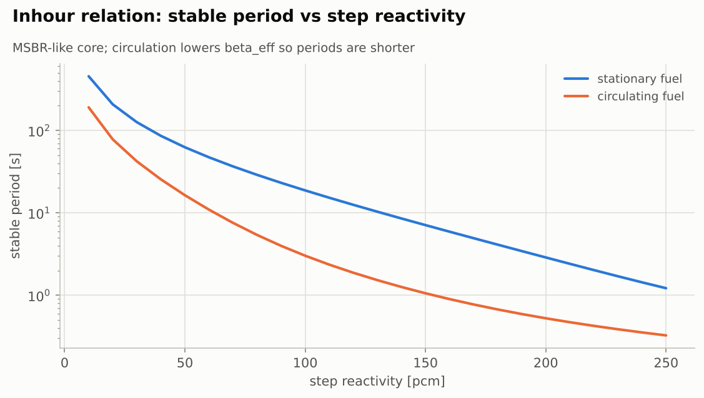
*Period curves from the eigenvalues of the kinetics system.*

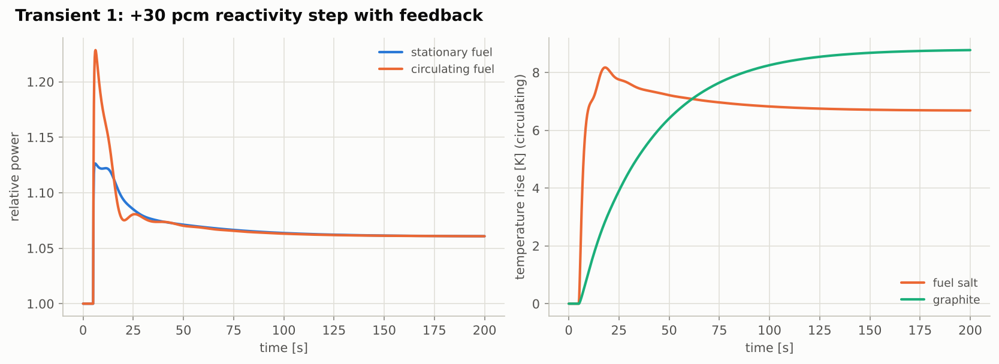
*Negative temperature feedback turns the excursion over and settles at a new power level.*

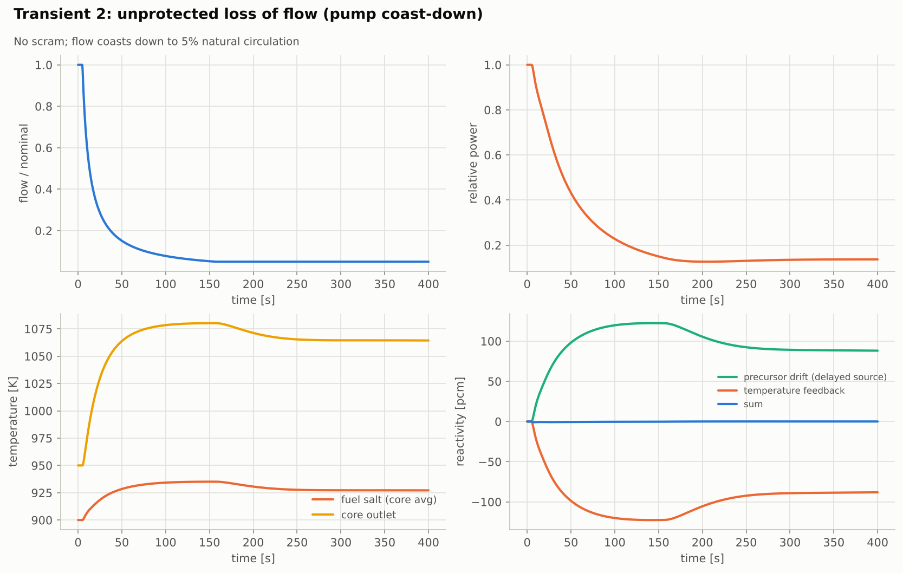
*Slower flow keeps precursors in-core (positive reactivity); fuel heating compensates and power falls to match heat removal.*

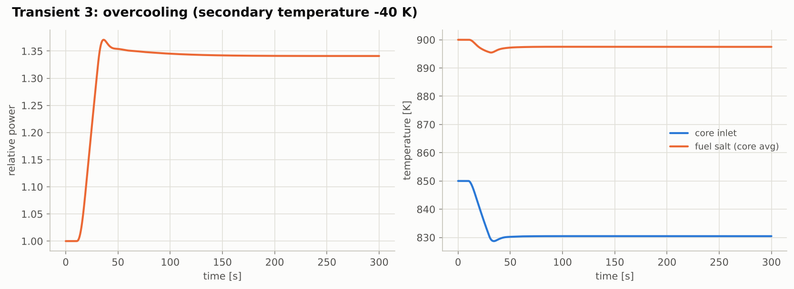
*The reactor follows the load: colder inlet salt adds reactivity and power rises until temperatures recover.*

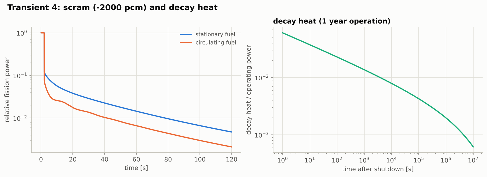
*Circulation removes precursors from the core, so fission power falls faster after scram.*

## 6. Xenon and samarium poisoning with off-gas sparging

One-group I/Xe/Pm/Sm balance on the inventory-averaged flux; worths calibrated against direct 2D transport calculations with the poison added to the salt.

**Poison parameters (TMSR-LEU, 250 MWth)**

| quantity | value |
|---|---|
| salt-averaged flux [n/cm2/s] | 1.448e+14 |
| one-group sigma_a Xe-135 [b] | 8.322e+05 |
| one-group sigma_a Sm-149 [b] | 2.570e+04 |
| yields I-135 / Xe-135 / Pm-149 | 0.0628 / 0.0025 / 0.0108 |
| transport calibration factor | 1.188 |
| equilibrium Xe worth, no sparging [pcm] | -2711.3 |
| equilibrium Sm worth [pcm] | -518.5 |

**Xenon after shutdown**

| case | equilibrium worth [pcm] | peak worth [pcm] | time of peak [h] |
|---|---|---|---|
| no sparging | 2711.3 | 6674.5 | 9.1 |
| sparging, 60 min | 915.2 | 1081.7 | 1.2 |
| sparging, 5 min | 110.4 | 110.4 | 0 |

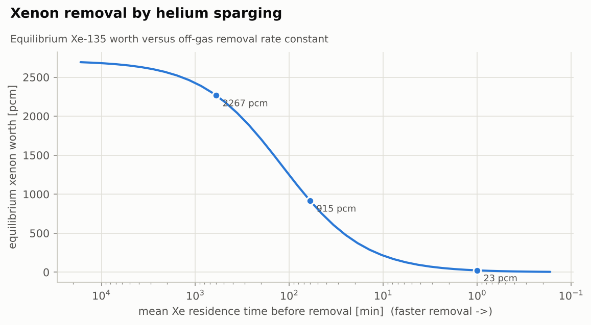
*Removing Xe on a ~1 minute time scale nearly eliminates xenon poisoning - a unique MSR advantage.*

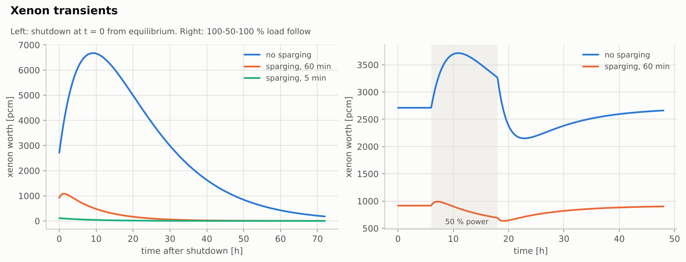
*The post-shutdown iodine pit that limits restart in solid-fuel reactors is suppressed by sparging.*

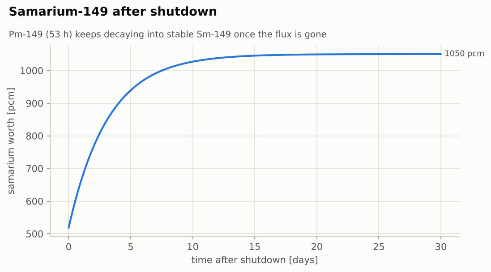
*Samarium worth rises to a new plateau after shutdown.*

## 7. Burnup and depletion with online fuel processing

CE/CM predictor-corrector with CRAM-16, 2D-calibrated lattice transport, fissile feed/extraction to hold k_eff = 1 and fertile make-up.

**MSBR-like depletion (k_eff held at 1.000 by fissile feed/extraction)**

| processing | years | burnup [MWd/kgHM] | breeding ratio | fissile [kg] | net fissile gain [kg/yr] | Pa-233 [kg] | Xe absorption [%] | wall time [s] |
|---|---|---|---|---|---|---|---|---|
| no processing | 4.6 | 47 | 0.8402 | 2081 | -246.9 | 82.1 | 1.732 | 2.5 |
| He sparging only | 4.6 | 47 | 0.8919 | 1898 | -165 | 86.8 | 0.009 | 2.3 |
| MSBR reference | 4.6 | 47 | 1.0831 | 1450 | 31.2 | 7.4 | 0.01 | 2.3 |

**Depletion transport options**

| model | transport calls | wall time [s] | final BR | max \|dBR\| vs reference |
|---|---|---|---|---|
| 2D core (6 groups) | 65 | 18.8 | 1.0915 | reference |
| 2D-calibrated lattice | 65 | 0.8 | 1.0967 | 0.0052 |
| ML-accelerated lattice | 114 physics + 72 ML | 1.6 | 1.083 | 0.00044 |

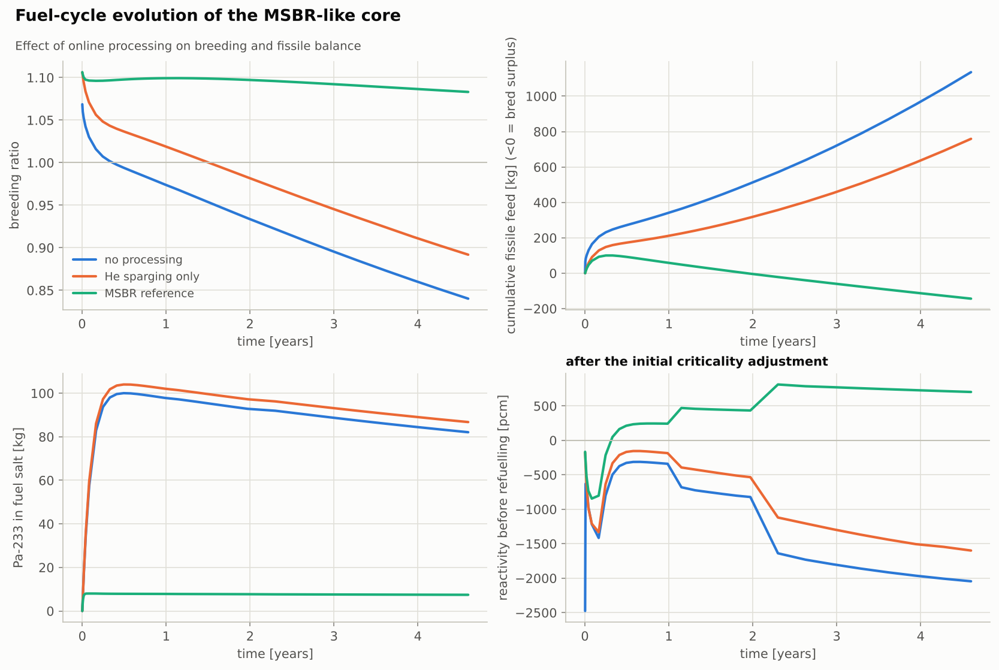
*Only with rare-earth removal and Pa isolation does the thorium core breed (BR > 1) and produce surplus U-233.*

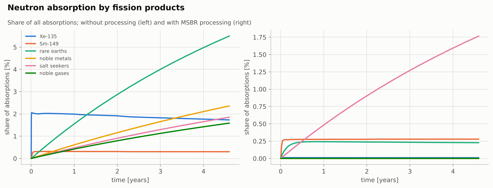
*Sparging removes Xe-135 and noble gases, chemical processing removes rare earths.*

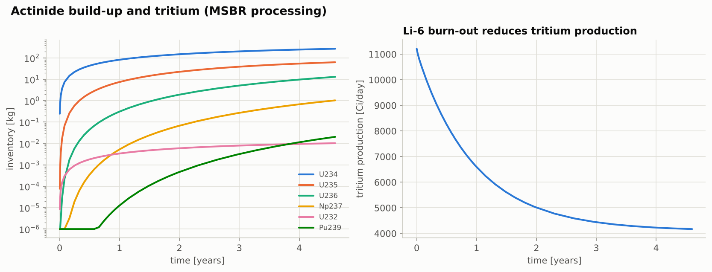
*U-232 builds up through Th-232(n,2n); tritium falls as the initial Li-6 burns out.*

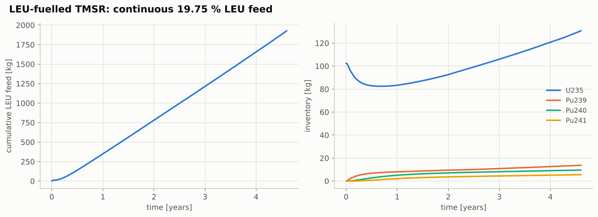
*Plutonium builds up from U-238 while LEU feed compensates burnup.*

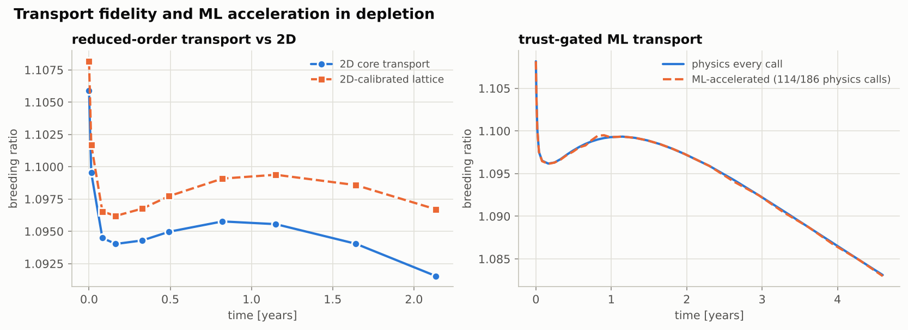
*The fast lattice model tracks the 2D model; the ML-accelerated run reproduces the physics run.*

## 8. AI/ML surrogate modelling with accuracy control

Nine-parameter thorium-breeder design space; high-fidelity data from the full 2D core sequence, low-fidelity data from lattice+B1.

**Design space (Latin hypercube, 300 high-fidelity 2D core solutions)**

| parameter | low | high | unit |
|---|---|---|---|
| Salt volume fraction | 0.08 | 0.4 |  |
| UF4 [mol%] | 0.15 | 0.6 | mol% |
| ThF4 [mol%] | 6 | 14 | mol% |
| Core radius [cm] | 120 | 260 | cm |
| H/D | 0.7 | 1.5 |  |
| Reflector [cm] | 20 | 80 | cm |
| Channel radius [cm] | 0.5 | 3 | cm |
| Fuel temperature [K] | 850 | 1000 | K |
| Li-6 [ppm] | 5 | 500 | ppm |

**Response ranges in the dataset**

| output | min | max |
|---|---|---|
| k_eff | 0.7759 | 1.6673 |
| conversion_ratio | 0.2419 | 1.7186 |
| alpha_fuel | -12.207 | -1.3216 |
| power_peaking | 1.3713 | 2.5459 |
| graphite_life | 1.0969 | 21.036 |
| fissile_kg | 353.72 | 5287 |
| leakage | 0.0207 | 0.1432 |

**5-fold cross-validation (240 training designs)**

| output | model | RMSE | max \|err\| | R2 | 95% coverage |
|---|---|---|---|---|---|
| k_eff | Gaussian process | 534.44 | 2784.2 | 0.99925 | 0.96 |
| k_eff | deep ensemble | 973.84 | 4378.4 | 0.99751 | 0.84 |
| k_eff | gradient boosting | 5235.9 | 15218 | 0.92816 | 0.68 |
| k_eff | polynomial ridge | 1818 | 6040.4 | 0.99134 | 0.75 |
| conversion_ratio | Gaussian process | 0.0074 | 0.0328 | 0.99931 | 0.88 |
| conversion_ratio | deep ensemble | 0.0093 | 0.045 | 0.99892 | 0.85 |
| conversion_ratio | gradient boosting | 0.069 | 0.2433 | 0.94085 | 0.78 |
| conversion_ratio | polynomial ridge | 0.038 | 0.1323 | 0.98209 | 0.98 |
| alpha_fuel | Gaussian process | 0.1493 | 0.728 | 0.99409 | 0.93 |
| alpha_fuel | deep ensemble | 0.18 | 0.7689 | 0.99141 | 0.84 |
| alpha_fuel | gradient boosting | 0.7254 | 3.1241 | 0.86054 | 0.71 |
| alpha_fuel | polynomial ridge | 0.3172 | 1.6198 | 0.97333 | 1 |

**Multi-fidelity accuracy (k_eff test RMSE, pcm)**

| HF samples | single-fidelity GP | multi-fidelity GP | LF model alone |
|---|---|---|---|
| 15 | 6211.2 | 580 | 4155.3 |
| 30 | 2834.8 | 885.2 | 4155.3 |
| 60 | 1782.3 | 339.7 | 4155.3 |
| 120 | 774.7 | 180.9 | 4155.3 |
| 240 | 528.1 | 103.9 | 4155.3 |

**Cost per design evaluation**

| model | seconds | relative |
|---|---|---|
| 2D core (6 groups, 4 processes) | 0.1566 | 1 |
| lattice + B1 (low fidelity) | 0.00305 | 51.4 |
| Gaussian-process surrogate | 6.51e-06 | 24063x faster |

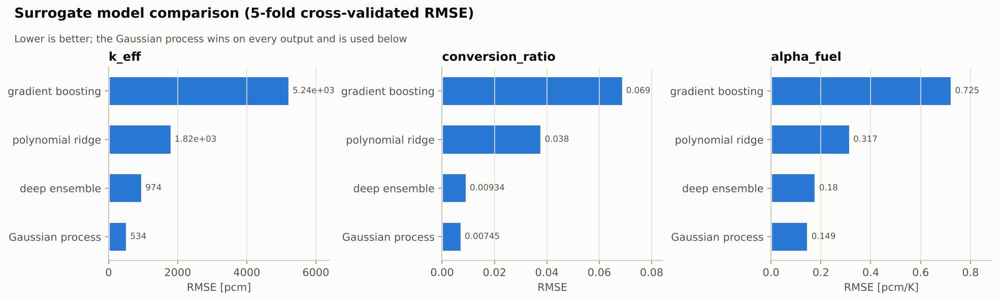
*Cross-validated accuracy of four surrogate families.*

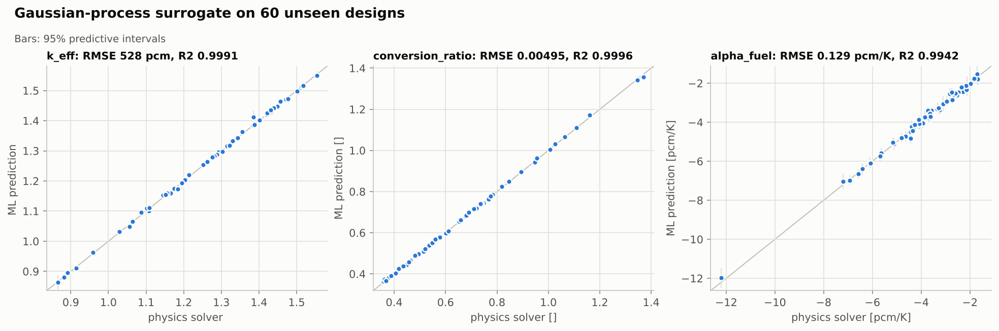
*Predicted vs physics on held-out designs.*

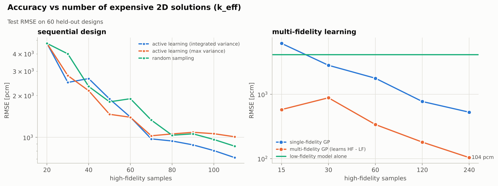
*Learning the discrepancy to a cheap physics model reaches ~100 pcm with a few hundred 2D runs.*

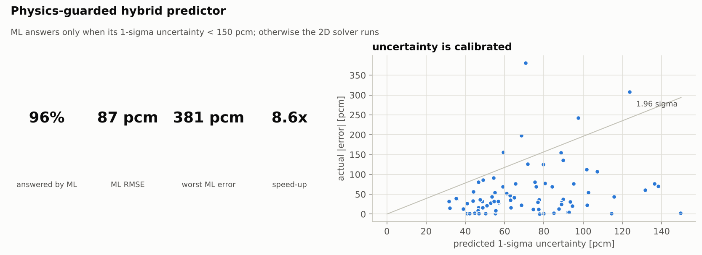
*Accuracy is maintained by construction: uncertain queries fall back to physics and retrain the model.*

## 9. Parameter reduction and reduced-order modelling

Variance-based sensitivity on the GP surrogate identifies the few design parameters that matter; POD and PCA compress fields and cross-section tables.

**Sobol indices**

| parameter | k_eff S1 | k_eff ST | CR S1 | CR ST |
|---|---|---|---|---|
| Salt volume fraction | 0.1119 | 0.117 | 0.1412 | 0.1492 |
| UF4 [mol%] | 0.6215 | 0.6257 | 0.5712 | 0.6031 |
| ThF4 [mol%] | 0.2118 | 0.2135 | 0.2352 | 0.2651 |
| Core radius [cm] | 0.01 | 0.0111 | -0 | 0.0006 |
| H/D | 0.0012 | 0.0013 | 0.0003 | 0.0003 |
| Reflector [cm] | 0.0007 | 0.0009 | -0 | 0.0002 |
| Channel radius [cm] | 0.0189 | 0.0195 | 0.0144 | 0.0199 |
| Fuel temperature [K] | 0.0001 | 0.0001 | 0 | 0.0001 |
| Li-6 [ppm] | 0.0184 | 0.0201 | 0.0005 | 0.0008 |

**Leading active direction w1 (unit-cube coordinates)**

| parameter | weight |
|---|---|
| UF4 [mol%] | 0.8522 |
| ThF4 [mol%] | -0.4102 |
| Salt volume fraction | -0.2511 |
| Li-6 [ppm] | -0.1396 |
| Channel radius [cm] | 0.1197 |
| Core radius [cm] | 0.0852 |
| H/D | 0.0286 |
| Reflector [cm] | 0.0225 |
| Fuel temperature [K] | -0.0096 |

**Reduced-input surrogate accuracy**

| m | parameters kept | test RMSE [pcm] |
|---|---|---|
| 1 | UF4 [mol%] | 11818 |
| 2 | UF4 [mol%], ThF4 [mol%] | 7796.4 |
| 3 | Salt volume fraction, UF4 [mol%], ThF4 [mol%] | 4430.1 |
| 4 | Salt volume fraction, UF4 [mol%], ThF4 [mol%], Li-6 [ppm] | 3619.8 |
| 5 | top 5 | 2433.6 |
| 6 | top 6 | 1321.4 |
| 7 | top 7 | 1128.3 |
| 8 | top 8 | 658.4 |
| 9 | top 9 | 528.1 |

**XS functionalization max relative error [%] (40 held-out states)**

| constant | polynomial | GP |
|---|---|---|
| D1 | 0.0037 | 0.0029 |
| D2 | 0.0031 | 0.0019 |
| Sa1 | 0.0455 | 0.0366 |
| Sa2 | 0.1203 | 0.0904 |
| nSf1 | 0.0843 | 0.0871 |
| nSf2 | 0.1035 | 0.1272 |
| kSf1 | 0.0842 | 0.0871 |
| kSf2 | 0.1035 | 0.1272 |
| S12 | 0.337 | 0.0681 |
| S21 | 0.9361 | 0.1234 |

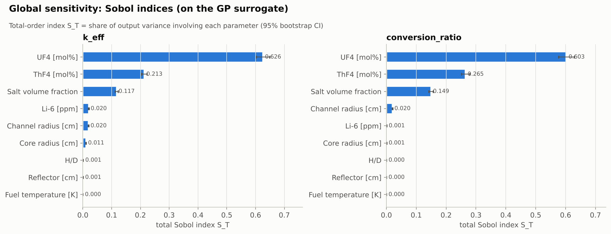
*UF4, ThF4 and salt fraction carry ~95% of the variance; fuel temperature, H/D and reflector thickness have S_T < 0.002.*

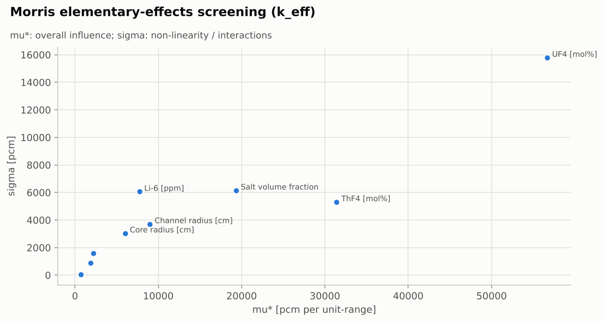
*Screening with 600 surrogate evaluations reproduces the Sobol ranking.*

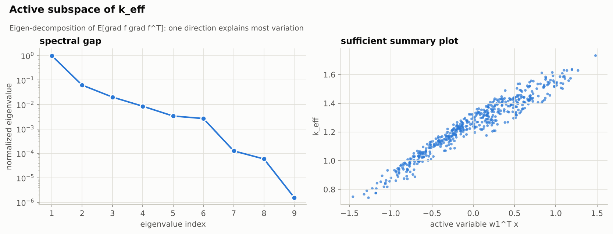
*A single linear combination of the nine inputs captures the trend of k_eff (1-D reduced model).*

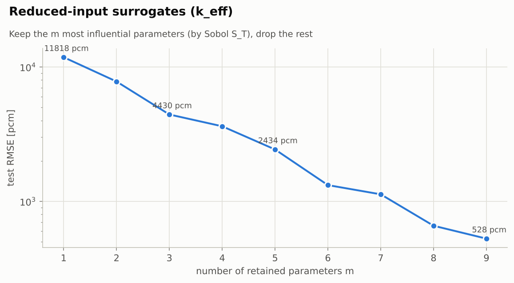
*The top 3 inputs carry 95% of the variance, but k spans ~+/-12,000 pcm, so even S_T = 0.002 is ~500 pcm: drop an input only if sqrt(S_T * Var) is below the accuracy target.*

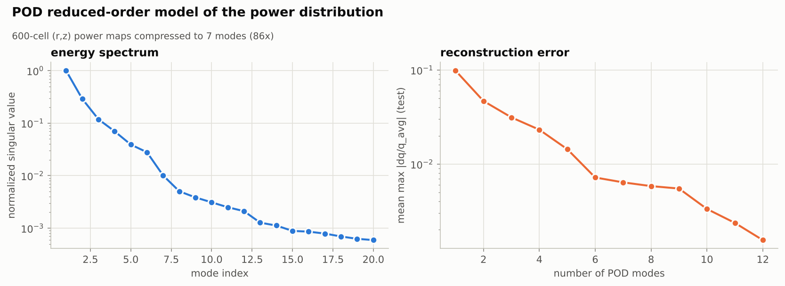
*A handful of modes reproduces any power distribution in the design space.*

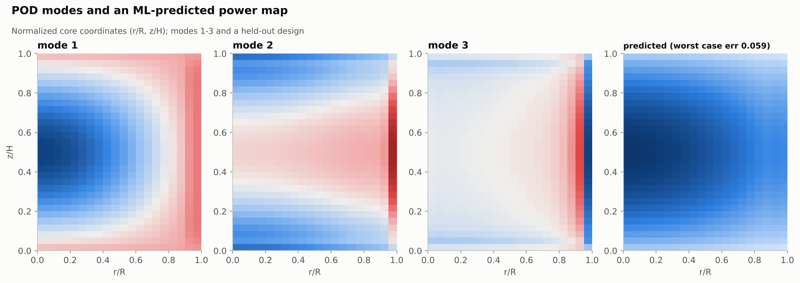
*Mode 1 is the fundamental shape; higher modes encode radial/axial tilts.*

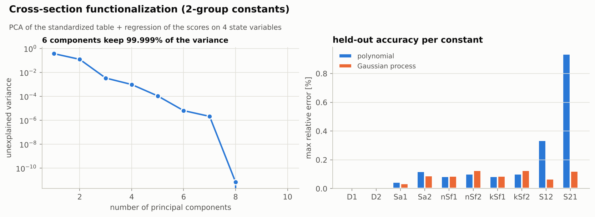
*10 tabulated constants on a 4-D state grid replaced by 6 smooth functions.*

## 10. Uncertainty quantification and design optimization

Direct-perturbation sensitivities on the full 2D core, Monte Carlo propagation through Gaussian-process surrogates, and constrained Bayesian optimization.

**Nuclear-data sensitivity (2D core, 2% perturbations)**

| nuclide reaction | S | rel. unc. | contribution [pcm] |
|---|---|---|---|
| Th232 capture | -0.484 | 0.02 | 967.9 |
| U233 nu | 0.9972 | 0.003 | 299.2 |
| U233 fission | 0.4797 | 0.006 | 287.8 |
| U233 capture | -0.054 | 0.03 | 162.1 |
| C12 capture | -0.0252 | 0.05 | 125.9 |
| C12 elastic | 0.1581 | 0.005 | 79 |
| Li7 capture | -0.0114 | 0.05 | 57.2 |
| F19 capture | -0.0052 | 0.08 | 41.2 |
| Be9 n2n | 0.0023 | 0.08 | 18.6 |
| F19 elastic | 0.0089 | 0.02 | 17.8 |
| Li6 nalpha | -0.0118 | 0.005 | 5.9 |
| Be9 capture | -0.0004 | 0.1 | 4.3 |
| F19 inelastic | 0.0002 | 0.1 | 1.9 |
| Th232 elastic | 0.0009 | 0.02 | 1.8 |

**Best design found by Bayesian optimization (verified by physics)**

| quantity | value |
|---|---|
| Salt volume fraction | 0.3784 |
| UF4 [mol%] | 0.3105 |
| ThF4 [mol%] | 13.401 |
| Core radius [cm] | 253.76 |
| H/D | 0.9039 |
| Reflector [cm] | 76.488 |
| Channel radius [cm] | 1.9414 |
| Fuel temperature [K] | 987.41 |
| Li-6 [ppm] | 9.0878 |
| k_eff | 1.0206 |
| conversion ratio | 1.0986 |
| alpha_fuel [pcm/K] | -6.663 |
| U-233 inventory [kg] | 2249.8 |

**Pareto designs: surrogate vs physics (pass 1 = initial, pass 2 = after refinement)**

| pass | CR target | CR (ML) | CR (physics) | k_eff (ML) | k_eff (physics) | U-233 kg (ML) | U-233 kg (physics) | feasible (physics) |
|---|---|---|---|---|---|---|---|---|
| 1 | 0.9 | 0.9301 | 0.9383 | 1.0317 | 1.0187 | 366 | 369 | no |
| 1 | 0.96 | 0.9726 | 0.9732 | 1.0264 | 1.0196 | 455 | 454 | no |
| 1 | 1.02 | 1.024 | 1.0206 | 1.0269 | 1.0264 | 614 | 615 | yes |
| 1 | 1.08 | 1.0892 | 1.0835 | 1.0242 | 1.0199 | 1077 | 1078 | no |
| 1 | 1.14 | 1.1502 | 1.1472 | 0.9893 | 0.9886 | 1945 | 1945 | no |
| 1 | 1.2 | 1.2125 | 1.2103 | 0.9685 | 0.9657 | 1838 | 1841 | no |
| 2 | 0.9 | 0.915 | 0.9114 | 1.0249 | 1.0207 | 347 | 347 | yes |
| 2 | 0.96 | 0.9706 | 0.9636 | 1.0259 | 1.0228 | 435 | 433 | yes |
| 2 | 1.02 | 1.0283 | 1.0257 | 1.0232 | 1.0246 | 631 | 631 | yes |
| 2 | 1.08 | 1.0878 | 1.0873 | 1.0243 | 1.0245 | 1454 | 1451 | yes |
| 2 | 1.14 | 1.1474 | 1.1428 | 0.9931 | 0.9936 | 1800 | 1795 | no |
| 2 | 1.2 | 1.209 | 1.2063 | 0.9669 | 0.9672 | 1495 | 1496 | no |

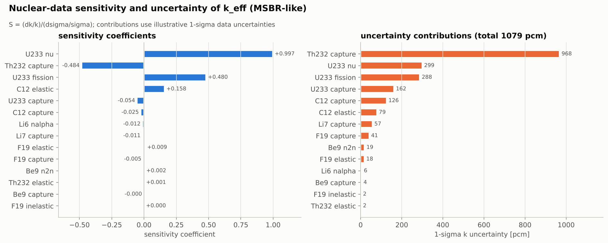
*Th-232 capture dominates, then U-233 nu/fission/capture; graphite and carrier-salt (Li-7, F-19, Be-9) data add the rest.*

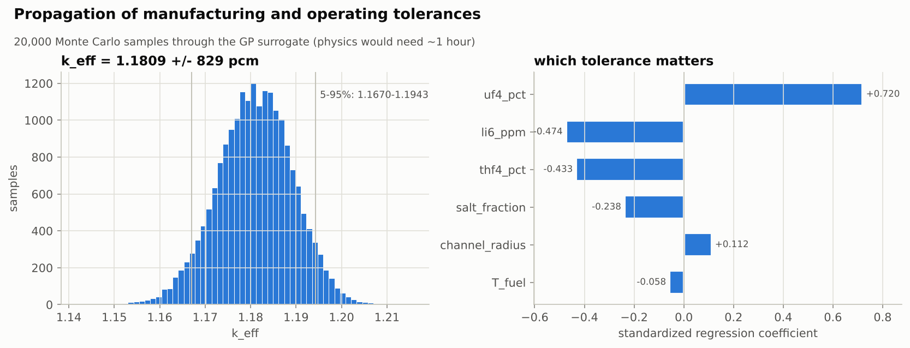
*Fissile loading and salt-fraction tolerances drive the k_eff spread.*

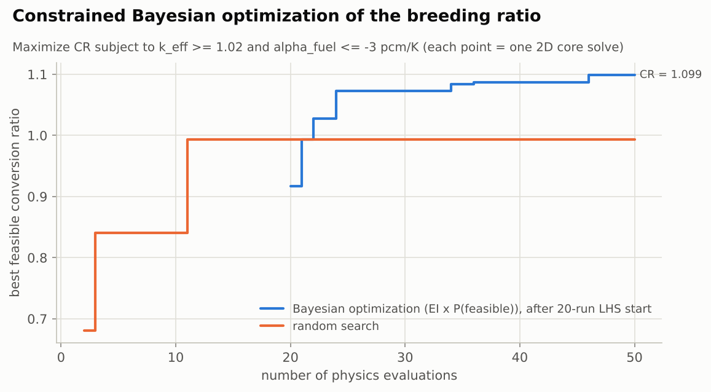
*Bayesian optimization finds better feasible designs with fewer expensive runs.*

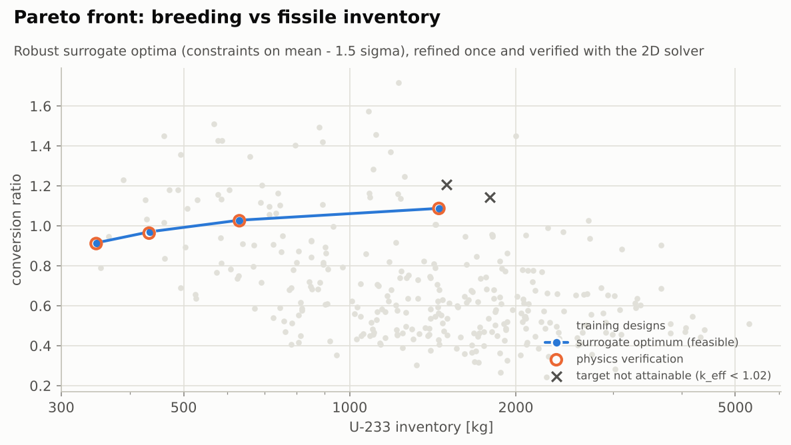
*Every extra unit of breeding costs fissile inventory; the 2D solver confirms the feasible optima, and both model and physics agree that CR >= 1.14 cannot be reached with k_eff >= 1.02 in this design space.*
